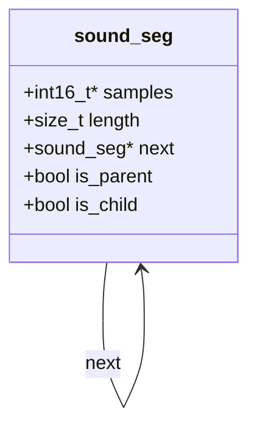
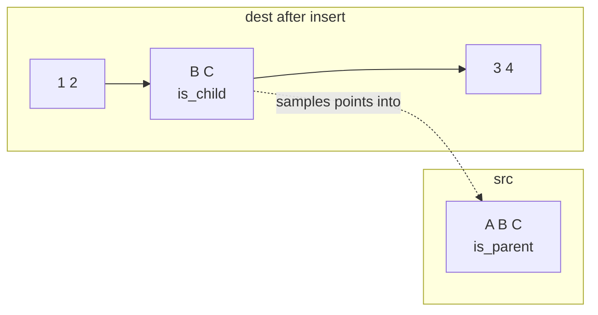

# AudioBox: Shared-Sample Audio Editing Library in C

This is a **C library for editing 16-bit audio tracks without copying samples**. A track is a linked list of segments. Reading, writing and deleting work across segment boundaries as if the track were one array. **Inserting part of one track into another shares the samples instead of copying them.** The source becomes a *parent*, the inserted piece becomes a *child*, and a write to either one is heard in both. The library can also load and save mono WAV files, and can find where a short clip (an "ad") occurs in a longer track by cross-correlation.

---

## Contents

1. [Quick start](#1-quick-start)
2. [Usage](#2-usage)
3. [Files](#3-files)
4. [Architecture](#4-architecture)
5. [Operations](#5-operations)
6. [Parent and child rules](#6-parent-and-child-rules)
7. [WAV files](#7-wav-files)
8. [Ad detection](#8-ad-detection)
9. [Design decisions](#9-design-decisions)
10. [Testing](#10-testing)
11. [Known limitations](#11-known-limitations)

---

## 1. Quick start

```sh
make demo         # builds the audiobox program and runs the demo
make test         # builds and runs both test suites
```

The demo creates a melody and a jingle, inserts the jingle twice as an "ad", then finds the ads and cuts them out again:

```
1. Making a 6 s melody and a 1 s ad jingle
2. Inserting the ad at 2 s and 4 s (shared, not copied)
   broadcast is now 8.00 s
3. Loading 3_with_ads.wav back and cutting the ads out
  found ad at   2.00 s -   3.00 s
  found ad at   5.00 s -   6.00 s
4. Removed 2 ads. Result is 6.00 s and matches the original melody.
```

Each step is saved as a WAV file in `demo/out/`, so you can listen to the results.

---

## 2. Usage

### Building

| Command | Result |
|---|---|
| `make` | Builds `demo/audiobox` and the two test programs |
| `make demo` | Builds and runs the demo (see [Quick start](#1-quick-start)) |
| `make test` | Builds and runs both suites |
| `make test-asan` | Runs both suites with AddressSanitizer and UBSan. Any memory error shows as `CRASH` |
| `make output` | Runs `test-asan` and saves the result to `tests/output.txt` |
| `make clean` | Removes the built programs and `demo/out/` |

All builds use gcc with `-std=c11 -Wall -Wextra` and compile without warnings.

### The audiobox program

| Command | Does |
|---|---|
| `./demo/audiobox` | Runs the demo and writes four WAV files to `demo/out/` |
| `./demo/audiobox remove-ads <in.wav> <ad.wav> <out.wav>` | Finds every copy of `ad.wav` in `in.wav`, cuts them out and saves the result |

It works from any directory. The demo always writes to `out/` next to the program (`demo/out/`). Input files must be 16-bit mono WAV, and output is saved at 8000 Hz. To listen on Linux, use `aplay demo/out/3_with_ads.wav`, or open the files in any media player.

### Using the library in your own program

Include `sound_seg.h` and compile `sound_seg.c` with your code:

```c
#include "sound_seg.h"

int16_t data[] = {1, 2, 3, 4, 5};
struct sound_seg* track = tr_init();
tr_write(track, data, 0, 5);          // 1 2 3 4 5
tr_insert(track, track, 2, 0, 3);     // 1 2 [1 2 3] 3 4 5   (the copy shares samples 0-2)

int16_t out[8];
tr_read(track, out, 0, 8);            // out = 1 2 1 2 3 3 4 5
tr_destroy(track);
```

```sh
gcc -Wall my_program.c sound_seg.c -o my_program
```

---

## 3. Files

| File | Role |
|---|---|
| `sound_seg.h` | The `struct sound_seg` definition and the public function prototypes |
| `sound_seg.c` | The implementation: WAV I/O, track operations, parent/child checks, ad detection |
| `demo/audiobox.c` | The `audiobox` program: the demo and the `remove-ads` command |
| `tests/harness.h` | A small test runner. Every test runs in its own process, so a crash is reported and the rest still run |
| `tests/test_blackbox.c` | 60 black-box tests that use only the public functions |
| `tests/test_legacy.c` | The 15 tests from the original `test.c`, ported one for one |
| `tests/output.txt` | The output of the last `make output` run |
| `makefile` | Builds the program and runs the tests |
| `compile_flags.txt` | Include path for editors that use clangd |

---

## 4. Architecture

### 4.1 Data model



| Field | Meaning |
|---|---|
| `samples` | Pointer to this segment's samples. In a child it points **into another segment's buffer** |
| `length` | Number of samples in this segment |
| `next` | The next segment of the same track, or `NULL` |
| `is_parent` | Some of this segment's samples are shared by a child somewhere |
| `is_child` | This segment doesn't own its samples. It borrows them |

A track is a pointer to its **first segment**, which stays the track's handle for its whole life. The track's length is the sum of the lengths of all its segments. Positions passed to the API are positions in the whole track, not within a single segment.

### 4.2 What an insert does

The example is `tr_insert(src, dest, 2, 1, 2)`, with `src = A B C` and `dest = 1 2 3 4`:



1. **Split `dest` at `destpos`**, so the insert point falls between two segments.
2. **Build a chain of child segments**, one for each source segment the range touches. Each one points into the source buffer, so nothing is copied. Each source segment it touches is marked `is_parent`.
3. **Link the chain in at `destpos`.** At position 0 the first segment has to stay first (it's the handle), so its contents move to a new segment after the chain and the handle is left empty.

Because both tracks now use the same memory, `tr_write(src, …)` on `B C` also changes what `tr_read(dest, …)` returns, and the other way round.

### 4.3 Splitting a segment

Inserts and deletes both start by splitting a segment at a position (`split_at`):

| Segment | How it is split |
|---|---|
| Ordinary (owns its samples, nothing shares them) | The tail is copied into a new buffer |
| Shared (a parent or a child) | No copy. The new tail points into the **same** buffer and is marked `is_child`, so it doesn't own it. Every pointer into that buffer stays valid |

---

## 5. Operations

| Function | Does | On bad input |
|---|---|---|
| `tr_init()` | Creates an empty track | `assert` on allocation failure |
| `tr_destroy(track)` | Frees every segment. A child's samples are left to their owner | `NULL` is ignored |
| `tr_length(track)` | Total number of samples in all segments | — |
| `tr_read(track, dest, pos, len)` | Copies `len` samples from `pos` into `dest`, across segments | Prints a message and `exit(1)` if the range is past the end |
| `tr_write(track, src, pos, len)` | Overwrites `len` samples from `pos`. Writing past the end **grows** the track and fills any gap with zeros | `exit(1)` on a `NULL` track or source |
| `tr_delete_range(track, pos, len)` | Removes `len` samples from `pos`. Deleting part of an inserted piece leaves its source untouched | Returns `false` if the range is past the end or touches a parent segment |
| `tr_insert(src, dest, destpos, srcpos, len)` | Inserts `len` samples of `src` from `srcpos` into `dest` at `destpos`, **shared** (see [§4.2](#42-what-an-insert-does)). `src` and `dest` may be the same track | `exit(1)` if out of bounds. Prints a message and does nothing if the [parent/child rules](#6-parent-and-child-rules) forbid it |
| `tr_check_parent_child(src, dest, destpos, srcpos, len)` | Returns `1` if that insert is allowed, otherwise `0` | Returns `0` |
| `tr_identify(target, ad)` | Finds where `ad` occurs in `target` (see [§8](#8-ad-detection)) | Returns `""` |
| `wav_load`, `wav_save`, `get_wav_sample_count` | WAV file I/O (see [§7](#7-wav-files)) | A file that can't be opened is ignored, and its sample count is 0 |

---

## 6. Parent and child rules

Shared samples make some edits ambiguous, so they are refused:

| Rule | Checked by | Result |
|---|---|---|
| The source range must not already be a parent or a child. Samples are shared only one level deep, and only once | `tr_check_parent_child` | Insert is skipped |
| The samples on either side of `destpos` must not be a parent or a child | `tr_check_parent_child` | Insert is skipped |
| A delete range must not touch a parent segment, because its children would be left pointing at freed memory | `tr_delete_range` | Returns `false` |
| Growing a track whose last segment is shared adds a new segment instead of reallocating, so the shared buffer never moves | `tr_write` | — |
| `tr_destroy` frees a segment's `samples` only if it isn't a child | `tr_destroy` | Shared memory is freed once, by its owner |

---

## 7. WAV files

| Function | Does |
|---|---|
| `get_wav_sample_count(file)` | Reads the 44-byte header and returns `data size ÷ block align`, or 0 if the file can't be read |
| `wav_load(file, dest)` | Reads the header, then the sample data, into `dest`. `dest` must be big enough. Get the size from `get_wav_sample_count` |
| `wav_save(file, src, len)` | Writes a standard 44-byte header and `len` samples |

Files are always saved as **PCM, mono, 16-bit, 8000 Hz**. Loading assumes the plain 44-byte header layout, with no extra chunks between `fmt ` and `data`.

---

## 8. Ad detection

`tr_identify(target, ad)` slides `ad` along `target` one sample at a time and computes the cross-correlation at each offset `k`:

```
R_xy(k) = Σ target[k + i] · ad[i]
```

An offset counts as a match when `R_xy(k) ≥ 0.95 · R_xx(0)`, where `R_xx(0) = Σ ad[i]²` is the ad's correlation with itself. After a match the search jumps past the end of that match, so the matches never overlap. Both tracks are read in full, whatever their segment layout.

It returns a newly allocated string with one `start,end` pair per line (inclusive sample indices). The string grows as needed, and is `""` when there are no matches:

```
120,239
800,919
```

The caller must `free()` the result.

---

## 9. Design decisions

| Decision | Alternatives considered | Why this one |
|---|---|---|
| A track is a linked list of segments | One growing array per track | An insert only splits one segment and links in new ones. Nothing after the insert point has to be moved |
| Children point into the parent's buffer | Copy the inserted samples | Shared edits are the point of the library, and inserts take constant memory whatever their length |
| `is_parent` / `is_child` flags | Reference counts | Enough to enforce the sharing rules, and they keep the public struct small |
| Shared segments are split without copying ([§4.3](#43-splitting-a-segment)) | Always copy | Copying a shared buffer would break the link between parent and child |
| The first segment never changes identity | A separate track header struct | The API hands the first segment to the caller as the track itself, so it must stay valid and stay first |
| All position walking goes through one helper, `seg_at` | Each function walks the list itself | The original bugs were almost all in hand-written walks. One tested helper replaces six |

---

## 10. Testing

```sh
make test         # or: make test-asan
```

There are two suites, 75 tests in all. The last run is saved in `tests/output.txt`, and every test passes, including under AddressSanitizer and UBSan.

### Black-box tests (`tests/test_blackbox.c`, 60 tests)

These use only the public functions and check results through `tr_read`, `tr_length`, return values and exit codes. They were written **before** the bug fixes and run against the old code first. 36 of them failed or crashed, and between them they caught every bug in the table below.

| Group | Tests | Covers |
|---|---|---|
| init / destroy | 2 | Empty track, `NULL` |
| write | 11 | Overwrite, append, grow, zero fill, 0 samples, `NULL` source, across segments, growing shared tracks |
| read | 3 | Partial range, 0 samples, past the end |
| insert | 15 | Middle, start, end, empty track, sharing in both directions, segment boundaries, multi-segment sources, refused inserts, out of range |
| self-insert | 7 | Middle, start, end, source around the insert point, sharing, protected source, multi-segment |
| check | 3 | Clean, shared source, multi-segment source |
| delete | 9 | Middle, everything, 0 samples, past the end, whole first segment, whole inserted segment, across segments, part of an inserted piece, shared source |
| destroy order | 1 | Destroying the source before or after its copy |
| identify | 6 | One, two and no matches, ad longer than target, multi-segment target, 400 matches |
| wav | 3 | Round trip, header fields, missing file |

### Legacy tests (`tests/test_legacy.c`, 15 tests)

These are the 15 tests from the original `test.c`, one for one, with every original check kept. The original only checked lengths in several places. The ports also compare the samples (for example, test 8 now checks `1 2 1 2 3 3 4 5`, where the original's unused `expected` array was wrong). The original `test.c` was also run unchanged against the fixed library, and all 15 passed, before it was removed.

### Bugs found and fixed

| # | Function | Bug |
|---|---|---|
| B1 | `tr_read` | Reads spanning segments returned the wrong samples (the offset went negative) |
| B2 | `tr_delete_range` | Deleting a whole segment miscounted and skipped the next one |
| B3 | `tr_delete_range` | Deleting the first segment freed memory still in use, and the track handle itself |
| B4 | `tr_delete_range` | Deleting part of an inserted piece shifted the *source's* samples. Deleting all of it freed the source's memory |
| B5 | `tr_insert` | Inserting on a segment boundary dropped everything after it |
| B6 | `tr_insert` | Inserting at a boundary or the end of a multi-segment track overwrote the first segment |
| B7 | `tr_insert` | Inserting into an empty track dereferenced `NULL` |
| B8 | `tr_insert` | Only the source's first segment was used, whatever `srcpos` said |
| B9 | `tr_insert` | A self-insert didn't mark its source as shared, so the source could be deleted |
| B10 | `tr_write` | Growing a track ending in shared samples reallocated memory others pointed into |
| B11 | `tr_write` | Writing 0 samples to an empty track crashed |
| B12 | `tr_check_parent_child` | Used the first segment's length, not the track's |
| B13 | `tr_identify` | Read only the first segment, overflowed a fixed 1024-byte result, and wasn't in the header |
| B14 | WAV I/O | No check for a failed `fopen`, and a file handle was never closed |
| B15 | `tr_insert` | New segments' `is_parent` / `is_child` flags were never set (found by UBSan) |

---

## 11. Known limitations

- **Parent flags never clear.** There is no reference count, so a segment stays a parent after its last child is deleted, and from then on it can't be deleted or shared again.
- **Sharing is per segment, not per sample.** Inserting part of a segment marks the whole segment as a parent, so none of it can be deleted while it is shared.
- **Destroy order.** Destroying a source track before a track that borrows from it is safe, but the borrowing track must not be *read* after that.
- **Sharing is only one level deep.** A child can't be used as the source of another insert, and a source can only be shared once. This is by design (see [§6](#6-parent-and-child-rules)).
- **Saved files are always 8000 Hz mono**, whatever the rate of the file that was loaded.
